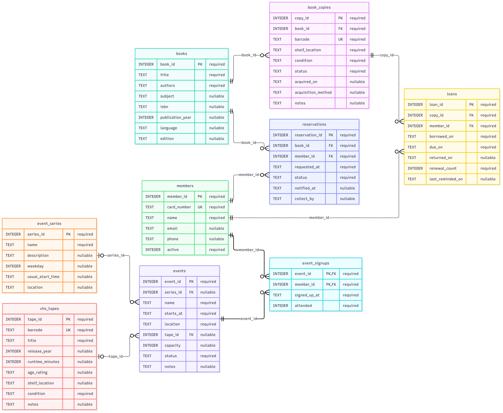
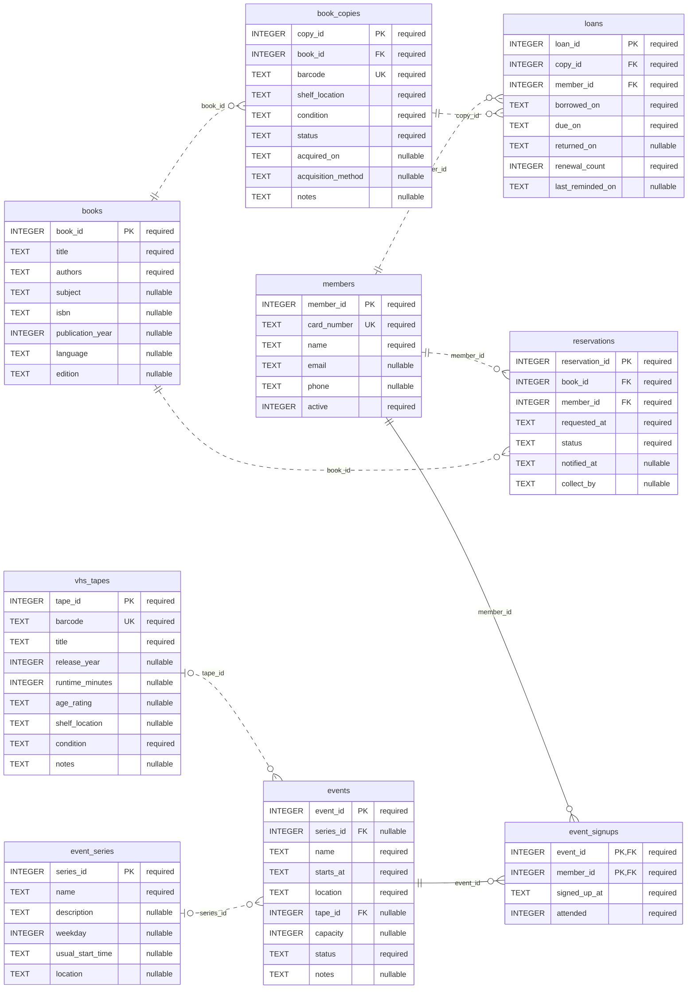

# Library database summary

My library is mostly about borrowing books, but I also wanted Friday night VHS movies. Just something fun where people can come in, have popcorn and watch an old movie.

The books table has the titles and authors. book_copies is for the copies we actually own and where they are. members has peoples names and contact details. loans keeps track of who took a copy, when its due and if it came back. reservations is the waiting list for books.

Then there is vhs_tapes for the movie tapes. event_series is the regular movie club, and events is each individual movie night. event_signups tells us who signed up and whether they came. So we can have people who only come for movies too.

One book can have many copies. One member can have many loans. These are one-to-many relationships, connected by IDs. Foreign keys point back to the right record. Members and events are many-to-many, because people can attend several nights and each night has several people. event_signups connects them. loans connects members and copies over time, and reservations connects members and book titles.

I separated books from copies because having a title doesn't tell us how many are on the shelf. If one copy is borrowed, another might still be there. Each copy gets its own barcode. We also block two open loans for the same copy.

One thing we changed was movie night. At first it was just a club idea. We then added actual example dates and signups so we could tell who came. June in the made-up data has never borrowed anything, but comes to movies. I think that makes sense for a small library.

## Mermaid source

